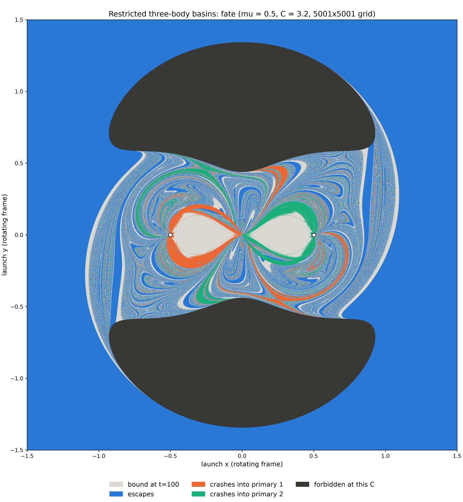
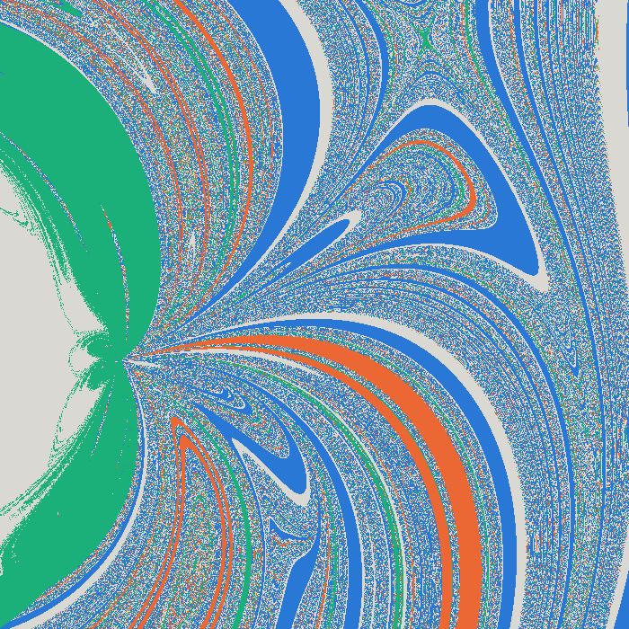

# Fractal basins in the three-body problem





These fractals show the end behavior of a test particle launched from each point of the plane, in the circular restricted three-body problem (equimassive primaries, Jacobi constant C = 3.2). These images have been rendered at 5001x5001 px (25 MP).

## The model

We are primarily investigating the circular restricted three-body problem, in which a massless third body moves around two massive bodies (primaries) that themselves move in circular orbits about their common center of mass.
We choose to approach this problem in the frame rotating with the two primaries. Units: G = 1, total mass 1,
separation 1, angular velocity 1. Primaries of mass 1 − μ and μ sit at (−μ, 0) and (1 − μ, 0), and the test particle is
massless:

$$\ddot x = 2\dot y + x - \frac{(1-\mu)(x+\mu)}{r_1^3} - \frac{\mu\,(x-1+\mu)}{r_2^3}, \qquad
\ddot y = -2\dot x + y - \frac{(1-\mu)\,y}{r_1^3} - \frac{\mu\,y}{r_2^3}$$

The Jacobi constant $C = 2\Omega - v^2$, with $\Omega = \tfrac12(x^2+y^2) + \tfrac{1-\mu}{r_1} + \tfrac{\mu}{r_2}$, is
conserved. Fixing C and launching perpendicular to the position vector (counter-clockwise) reduces the 4D phase space to
a 2D map of launch positions. Points where $2\Omega < C$ are forbidden. Below C ≈ 3.4568 the necks at the L2 and L3
points open, so the particle can escape.

| Fate | Meaning |
|---|---|
| bound | nothing happening, still bound at t = 100 |
| escapes | beyond r = 10 from the centre of mass, with positive energy in the inertial frame |
| crashes into primary 1 or 2 | comes within 10⁻³ of that primary's centre |
| forbidden | the launch point is not reachable at this C |

## Setup

```bash
sudo apt install g++ make libboost-dev      # C++17 compiler, make and the Boost headers (Ubuntu)
conda env create -f environment.yml
conda activate body-chaos-fractals
make                                        # builds the C++ integrator; rerun after editing fast.cpp
python -m pytest                            # tests: the C++ integrator against the scipy reference
```

## Running

Run everything from the repository root:

```bash
python -m runs.restricted_basins fixed_c          # C = 3.2 map at 601 × 601 (runtime: ~seconds)
python -m runs.restricted_basins fixed_c 5001     # same map at 5001 × 5001: (runtime: ~minutes)
python -m runs.restricted_basins rest             # launches at rest in the rotating frame (each with its own C)
python -m runs.restricted_basins fixed_c_inset    # the 601 map with its centre recomputed 3 times finer
python -m runs.fig8_perturb                       # full three-body problem (scipy; slow)
```

Results go to `data/` as `.npz` caches plus PNG figures. Cache names encode every parameter, and re-running a
command resumes an interrupted run. To use scipy instead of the C++ integrator, set
`INTEGRATE, TAG = fate_scipy, ""` in `runs/restricted_basins.py`, importing `fate_scipy` from
`systems/restricted/reference.py`.

## Layout

| Path | Contents |
|---|---|
| `lib/` | system-independent tools: `sweep.py` (parallel, resumable grid sweeps over any `fn(x, y)`), `plotting.py` |
| `systems/restricted/` | restricted problem: `model.py` (constants, effective potential, launch rule), `fate.py` (fate of each pixel; calls the C++ integrator), `fast.cpp` (C++ equations of motion, events and integrator), `reference.py` (the same in Python with scipy, for testing) |
| `systems/three_body/` | full planar three-body problem with softened gravity |
| `runs/` | scripts that produce the maps |
| `notebooks/` | figure-eight orbit plot and animation |
| `tests/` | pytest tests; run `python -m pytest` from the repository root |
| `Makefile` | builds `systems/restricted/_fast*.so` from `fast.cpp` |
| `compile_flags.txt` | include paths for clangd, specific to one machine; regenerate with `printf '%s\n' -std=c++17 -Wall $(python -m pybind11 --includes) > compile_flags.txt` |

## Accuracy

- **Integrator.** Maps use a 7(8)-order Runge–Kutta–Fehlberg method from Boost.Odeint (rtol 10⁻¹⁰, atol 10⁻¹²), compiled
  as a Python extension with pybind11. It is about 200 times faster than the original scipy `solve_ivp` (DOP853) code,
  which is kept in `systems/restricted/reference.py` for testing.
- **Chaos.** In chaotic regions, individual pixel fates are not reproducible. Shifting a launch by 10⁻⁹, or changing the
  integrator or its tolerance, can change them. The two integrators agree on 99.2% of the pixels of the 601 × 601 map,
  and essentially every disagreement sits on a basin boundary. The basin geometry and the fate statistics are robust;
  individual boundary pixels are not.
- **Event times.** The time of an escape or crash is taken at the end of the integration step in which it happened.
- **Symmetry.** With μ = 0.5, rotating a launch by 180° gives the same fate with the primaries swapped, so only half of
  each grid is integrated and the rest is mirrored.

## Full three-body problem

`runs/fig8_perturb.py` maps the fate of the figure-eight orbit (Moore 1993; Chenciner and Montgomery 2000) when one body's
starting position is shifted. It uses softened gravity (softening length 10⁻³) and scipy. This problem lies in a 12D parameter space and is thus incredibly chaotic on a 2D slice (basically just looks like noise), so we opted to tackle the more constrained problem outlined above instead.
